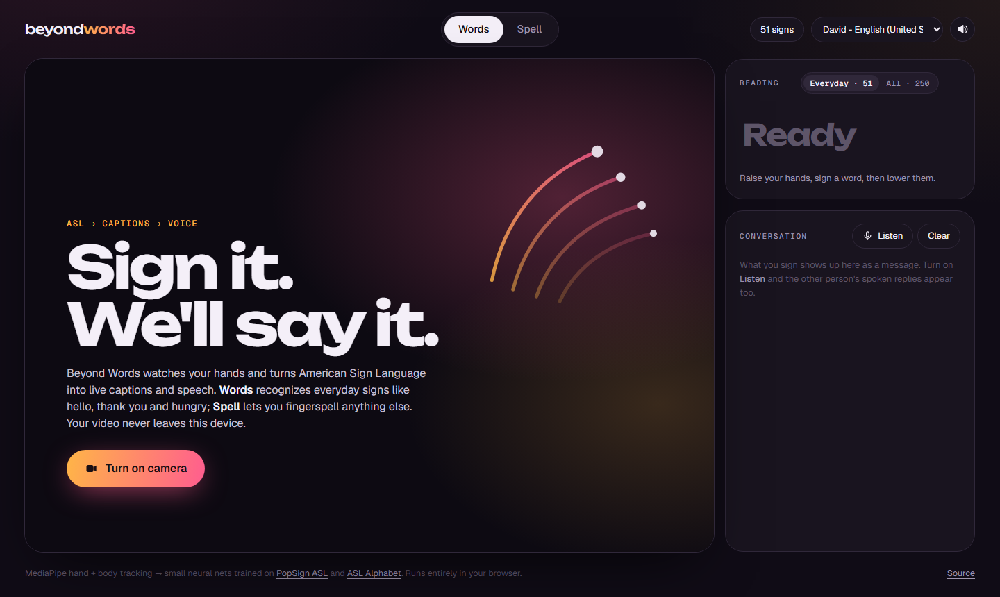
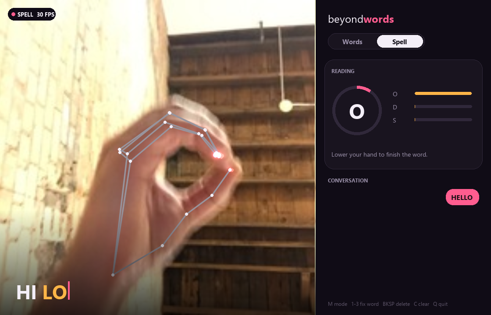

# Beyond Words

**Real-time American Sign Language → live captions → speech.**

Sign to your webcam and Beyond Words speaks for you. **Words** mode recognizes everyday ASL signs (hello, thank you, please, mom, hungry, tomorrow…): a focused list of 51 by default, or all 250 PopSign signs. **Spell** mode handles anything else through fingerspelling. Each word is captioned and spoken the moment you finish it, and a two-way conversation view transcribes the other person's spoken replies. It runs in the browser with nothing to install, or as a Python desktop app.



## What it does

- **Words, not just letters.** Sign a word with your hands up, then lower them. The sign is classified from the motion of both hands relative to your body, then captioned and spoken right away. If it guessed wrong, tap one of the alternatives it shows.
- **Fingerspelling.** Hold each letter for a moment and it's typed. Lower your hand and the word is finished and spoken automatically; there's no button to press.
- **Two-way conversation.** Turn on **Listen** and the other person's speech is transcribed into the same thread, so a Deaf signer and a hearing speaker can talk back and forth (Chrome and Edge).
- **Private by design.** Hand tracking, body tracking and both neural nets run locally. Video never leaves the device.

## How it works

```
webcam ─► MediaPipe Hands (×2) + Pose ─► landmarks
                                           │
              ┌────────────────────────────┴───────────────────────────┐
       WORDS: while hands are up, record                SPELL: one hand, one frame
              body + both hands per frame                      │
              │                                         21 keypoints, normalized
              hands drop ─► clip ─► 12-step sequence           │
              │                                         MLP 63 → 256 → 128 → 28
       temporal conv net (ONNX) ─► 250 signs            A–Z · space · del ─► hold-to-type
              └──────────────────────────┬─────────────────────────────┘
                                captions ─► speech
```

- **Landmarks, not pixels.** The models never see the image, only skeletons, which makes them fast and indifferent to lighting, skin tone and background.
- **Location-aware.** Word features put both hands in a body-centred frame (shoulder midpoint, shoulder width), so MOM at the chin and DAD at the forehead are different signs even though the handshape is the same.
- **Either hand.** Each clip is mirrored so the dominant hand always lands in the same slot, which lets left- and right-handed signers look the same to the model. A unit test checks that a mirrored clip produces identical features.
- **One model, two runtimes.** The word model is exported to ONNX (onnxruntime in Python, onnxruntime-web in the browser), and the letter model is plain JSON weights. The feature code exists in both Python and JavaScript and is checked to produce matching predictions.

## Results

| Model | Data | Evaluation | Accuracy |
|---|---|---|---|
| Words, Everyday (51 signs) | [PopSign ASL v1.0](https://huggingface.co/datasets/sign/popsign-images), CC BY 4.0 | Signers never seen in training | **56.2%** top-1 · **78.7%** top-5 |
| Words, All (250 signs) | PopSign ASL v1.0 | Signers never seen in training | **35.8%** top-1 · **60.1%** top-5 |
| Letters (A–Z, space, del) | [Kaggle ASL Alphabet](https://www.kaggle.com/datasets/grassknoted/asl-alphabet) | Held-out images, same signer | **99.0%** |
| Letters | [ASL Alphabet Test](https://www.kaggle.com/datasets/danrasband/asl-alphabet-test) | Different signer and backgrounds | **88.6%** |

The "never seen" rows are the honest numbers. Top-5 matters for words because the app shows the runner-up guesses as one-tap corrections. When the model isn't confident enough (below 40% for Everyday), it offers those guesses instead of speaking.

Why word accuracy is lower than letters: the public PopSign frames are sampled at only 5 fps, so a whole sign is about 6 frames, and motion blur hides the hands in roughly half of them. The 30 fps landmark release of the same signers ([Kaggle asl-signs](https://www.kaggle.com/competitions/asl-signs)) is the obvious next step for the word model.

## Run it

### In the browser

```bash
python scripts/serve.py
```

Open http://localhost:8000 in Chrome or Edge and click **Turn on camera**. Any static file server works; this one just disables caching so changes show up on refresh.

### Desktop app (Python 3.10+)



```bash
pip install -r requirements.txt
python app.py               # Words mode, 51 everyday signs
python app.py --all-signs   # Words mode, all 250 signs
python app.py --spell       # Spell mode
```

| Key | Action |
|---|---|
| `M` | Switch between Words and Spell |
| `1` `2` `3` | Replace the last word with an alternative |
| `BACKSPACE` | Delete |
| `C` | Clear |
| `Q` / `Esc` | Quit |

The MediaPipe hand and pose models (~14 MB) download automatically on first run.

## Retrain the models

**Words**

```bash
huggingface-cli download sign/popsign-images --repo-type dataset --include "data/non-game/*" --local-dir data/popsign
python scripts/extract_signs.py --split train
python scripts/extract_signs.py --split validation
python scripts/extract_signs.py --subset game --split train --download --every 3   # optional, more signers
python scripts/train_signs.py --name sign_full
python scripts/train_signs.py --name sign_core --signs bad,better,bye,dad,drink,find,fine,finish,food,give,go,happy,hate,have,hello,hesheit,home,hot,hungry,later,like,listen,look,mad,milk,minemy,mom,morning,night,no,now,please,sad,same,see,sick,sleep,sleepy,stay,thankyou,thirsty,time,tomorrow,wait,water,weus,where,who,why,yes,yesterday
```

**Letters**

```bash
python scripts/extract_landmarks.py --out data/landmarks.npz
python scripts/train.py --holdout data/holdout.npz   # holdout: landmarks of the ASL Alphabet Test set
```

Both write to `models/` and `web/model/`.

## Project layout

```
app.py                     desktop app (OpenCV + Pillow UI, speech)
beyondwords/
  signs.py                 word signs: body+hands capture, clip features, segmenter, ONNX model
  landmarks.py             MediaPipe hand wrapper + letter features
  classifier.py            letter MLP (JSON weights, NumPy inference)
  speller.py               hold-to-type fingerspelling with automatic word breaks
  speech.py                non-blocking text-to-speech
scripts/                   landmark extraction + training for both models
web/                       browser app (MediaPipe Tasks JS, onnxruntime-web)
models/                    trained models
tests/                     pytest suite
```

## Limitations

- **Isolated signs.** Lower your hands briefly between words. Continuous signing, where signs blend into each other, is a much harder research problem.
- **Limited vocabulary.** PopSign's 250 signs were chosen for everyday conversation with young children. Everything else can be fingerspelled.
- **No grammar.** Real ASL relies on facial expression, space and its own grammar. This translates sign by sign, as a gloss, not as fluent English.

Started in 2024 as an image-CNN prototype for the alphabet. Rebuilt around landmark tracking with word-level recognition.
